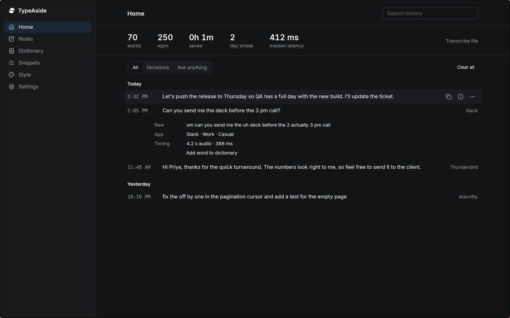
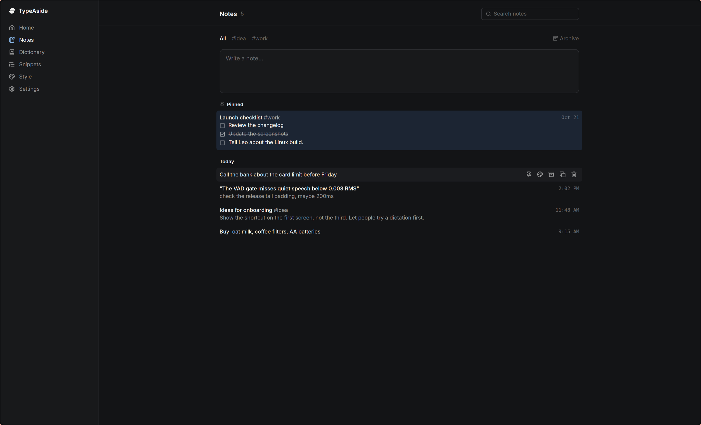
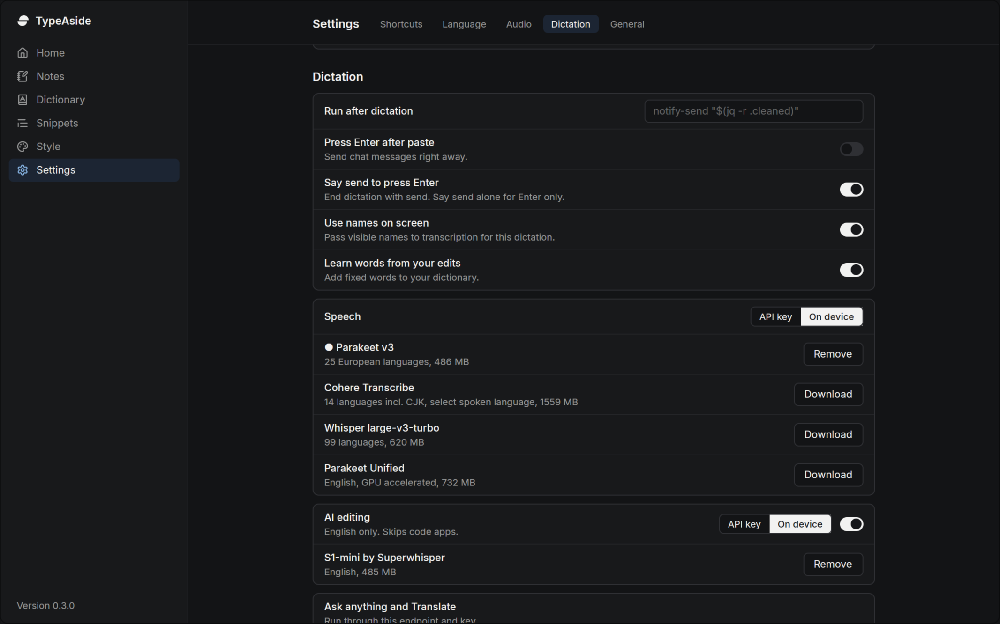
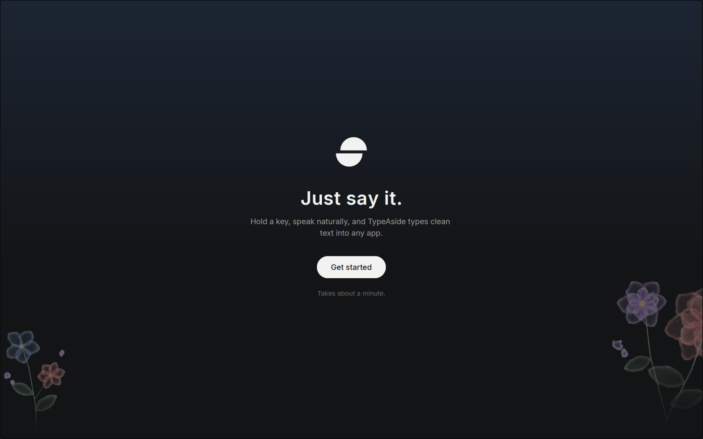

<p align="center">
  
</p>

<h1 align="center">TypeAside</h1>

<p align="center">
  <b>Just say it.</b><br>
  Native voice dictation for macOS, Windows and Linux.
</p>

<p align="center">
  <a href="https://typeaside.app/download"><b>Download</b></a> ·
  <a href="#install">Install</a> ·
  <a href="https://typeaside.app/docs">Docs</a> ·
  <a href="docs/local-models.md">On-device models</a> ·
  <a href="LICENSE">MIT license</a>
</p>

<p align="center">
  
</p>

Hold a key, speak, and the text lands where your cursor is. No account, no server, no telemetry. Audio and text go only where you point them: an on-device model, or an endpoint you configure.

## Features

- **On-device models.** Parakeet v3, Whisper, Cohere and Bark run entirely on your computer, with GPU acceleration on every platform and silence gating built in.
- **Bring your own key.** Point the app at any OpenAI-compatible speech endpoint (Groq works well). Your key lives in the system keychain.
- **AI editing.** Optional cleanup removes fillers and false starts. Command mode edits selected text or answers a spoken question. Translate into any language.
- **Works everywhere you type.** evdev hotkeys and a layer-shell overlay on Wayland, CGEventTap on macOS, a low-level hook on Windows. Injected text is verified against the field and falls back to the clipboard, so a dictation is never lost.
- **Notes, dictionary, snippets.** Quick local notes, custom vocabulary that biases recognition, text expansion, per-app styles, and corrections learned from your edits.

## Footprint

A native Rust and GPUI app, not Electron. Installers are 11 to 24 MB.

| App                               | Memory at idle                  | CPU at idle | Source                                                                                                                                                    |
| --------------------------------- | ------------------------------- | ----------- | --------------------------------------------------------------------------------------------------------------------------------------------------------- |
| **TypeAside**                     | **30 MB** (85 MB window open)   | **0%**      | Measured                                                                                                                                                  |
| **TypeAside**, Parakeet v3 loaded | 1.3 GB, freed after 30 min idle | **0%**      | Measured                                                                                                                                                  |
| Wispr Flow                        | 750 to 800 MB                   | about 8%    | [tl;dv test](https://tldv.io/blog/wispr-flow-notetaker-review/), [user reports](https://www.getvoibe.com/resources/best-wispr-flow-alternatives-windows/) |
| Superwhisper, local model loaded  | about 900 MB                    | 0%          | [User report](https://feedback.superwhisper.com/board/p/let-s1-mini-unload-when-superwhisper-is-idle)                                                     |

With Parakeet v3 on the CPU, 9.75 s of speech transcribes in 300 ms using 1.3 CPU-seconds. Measured as proportional set size on TypeAside 0.2.41 on Linux, Ryzen 9 8945HS. Competitor figures are third-party and vary by platform and version.

## Install

| Platform | Command                                                                 |
| -------- | ----------------------------------------------------------------------- |
| Linux    | `curl -fsSL https://typeaside.app/install.sh \| sh`                     |
| Arch     | `yay -S typeaside-bin`                                                  |
| macOS    | `brew install --cask adityamiskin/tap/typeaside`                        |
| Windows  | Installer from [typeaside.app/download](https://typeaside.app/download) |

## Screenshots

<table>
  <tr>
    <td></td>
    <td></td>
  </tr>
  <tr>
    <td align="center">Quick notes</td>
    <td align="center">On-device models</td>
  </tr>
</table>

<p align="center">
  
</p>

## Development

The desktop app is Rust and GPUI. Building needs CMake and, on Linux x86_64, Vulkan headers.

```bash
cargo check
cargo test
cargo run
```

The website (`apps/web`) is TanStack Start on Cloudflare Workers, built with Bun and Vite+. It needs no credentials to run.

```bash
bun install
bun run dev:web      # http://localhost:3001
bun run check        # format, lint and type checks
bun run build
```

| Path                         | What lives there                                                                           |
| ---------------------------- | ------------------------------------------------------------------------------------------ |
| `src/`, `assets/`, `vendor/` | Desktop app                                                                                |
| `apps/web`                   | Marketing site, docs and downloads                                                         |
| `packages/ui`                | Shared shadcn primitives and the Tailwind v4 theme                                         |
| `docs/`                      | [Platform notes](docs/platforms.md), [model catalog](docs/local-models.md), history limits |
| `examples/`                  | Runnable end-to-end checks for the pipeline and local models                               |
