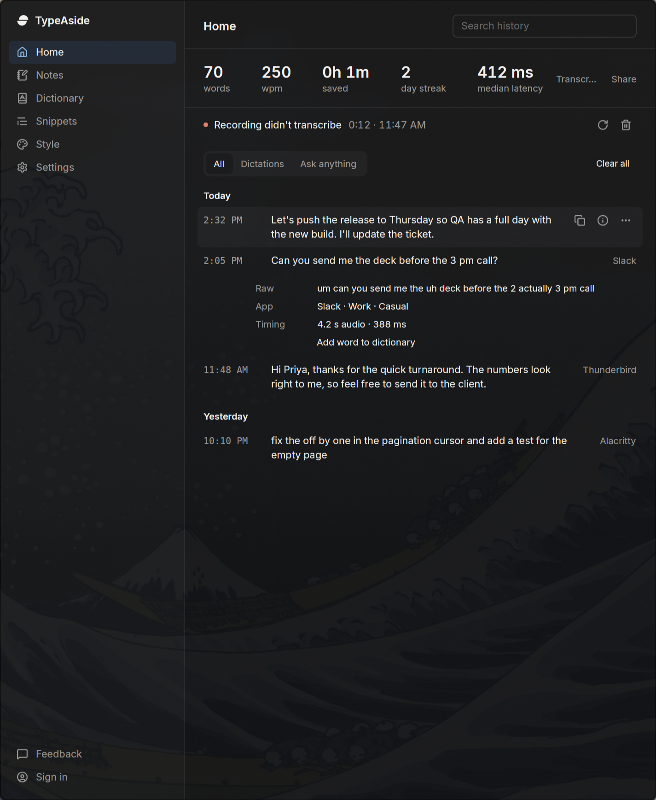

# Dictation history limits

History keeps at most 2,000 entries and 4 MiB of serialized JSONL, evicting the oldest timestamps first. Each entry stores at most 16 KiB of transcript text across raw and cleaned text, truncated at UTF-8 boundaries. Delivery still uses the full transcript. Failed audio keeps the newest 20 recordings within 200 MiB; evicted files and interrupted temporary files are removed.

The default retention is unchanged, labeled **Until full**. **Off** stops saving new transcripts and preserves existing history within the hard caps. **Clear all** requires confirmation. Individual transcript deletion and timed retention remain available.

History file reads and mutations share a process mutex. Deleting a transcript reads the current file under that lock, preserving transcripts concurrently added by the engine. Writes atomically replace the bounded file. Startup skips corrupt JSONL lines and applies the same caps as writes.

## Verification

The failure cases considered before implementation were corrupt JSONL lines, concurrent history writes/deletes, oversized text with UTF-8 and JSON escaping, and orphaned or excessive failed audio. Four focused pruning tests cover entry count, byte count, UTF-8, timed retention, Off, and both audio budgets.

These commands passed with `CARGO_TARGET_DIR=/home/aditya/Projects/typeaside-agent-target` and `CARGO_BUILD_JOBS=8`:

```bash
cargo build --config profile.dev.package.typeaside.opt-level=2 --config profile.dev.package.typeaside.codegen-units=7
cargo clippy --all-targets --config profile.dev.package.typeaside.opt-level=2 --config profile.dev.package.typeaside.codegen-units=7
cargo test --config profile.dev.package.typeaside.opt-level=2 --config profile.dev.package.typeaside.codegen-units=7
```

All 18 tests passed (16 library and two desktop tests), including all four history pruning tests. The package optimization and codegen overrides separate artifacts from other worktrees building concurrently in the shared target directory. The app binary was copied immediately after its successful build for runtime verification.

A normal app launch used fresh temporary directories for both `TYPEASIDE_HOME` and `XDG_RUNTIME_DIR`. The latter contained only a symlink to the compositor's Wayland socket before launch. No daily-driver instance socket or data was used. The home was seeded with 2,100 valid entries, one corrupt JSON line, one invalid UTF-8 line, 25 sparse 12 MiB WAV files, one invalid WAV filename, and an interrupted WAV temporary file.

```text
Before startup:      2,102 lines,   43,436,919 history bytes
After startup:       2,000 entries,  3,624,656 history bytes
Maximum stored text: 16,384 bytes per entry
Failed audio after:  16 files, 201,326,592 bytes (192 MiB)
After Off relaunch:  2,000 entries,  3,624,656 history bytes
History SHA-256 before and after Off:
4be385bb818ac612420cfa6785dd5c2ea5d37e95a86c22e395dd95637043bebd
```

For the Off check, the isolated app was stopped, `history_retention` was changed from `forever` to `off` in its isolated config, and the app was relaunched. Only verification child processes were terminated.

The screenshot is the real GPUI app launched with `--demo`, an isolated home/runtime, `TYPEASIDE_DEMO_PAGE=home`, `TYPEASIDE_THEME=dark`, and `TYPEASIDE_DEMO_HISTORY=1`. Demo mode uses fixtures rather than disk history, so the pruning evidence above comes from normal launches.



Unverified: live dictation and retry transcription, interactive Clear all confirmation/cancellation, and macOS/Windows runtime behavior. No E2E scripts or web checks were run.
