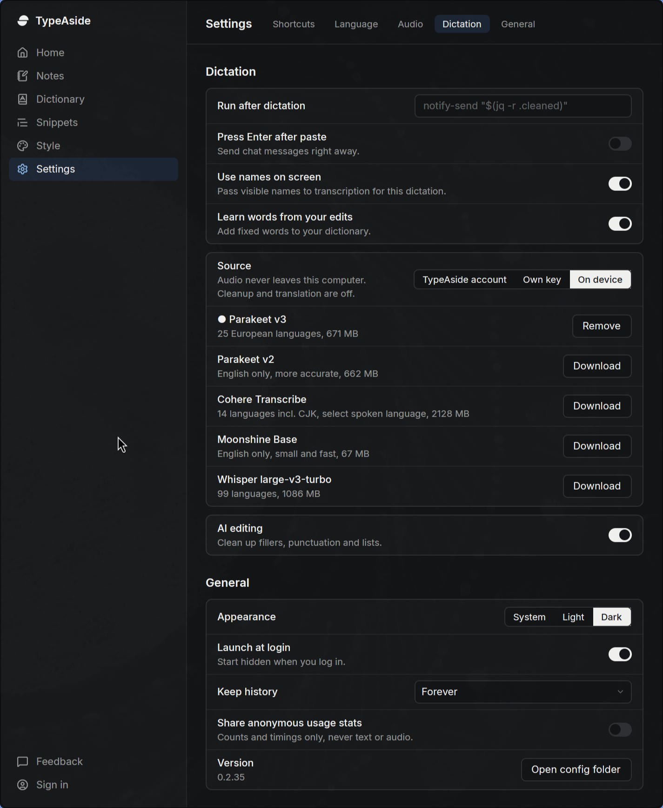

# On-device models

Settings → Dictation lists the available models. Download several, then use **Use** to switch. The dot marks the active model; its action is **Remove**. To remove another installed model, select it first. Only one download runs at a time. Source → On device appears when a model is installed.

| Model key        | Languages                                          | Assets   | Engine                             |
| ---------------- | -------------------------------------------------- | -------- | ---------------------------------- |
| `parakeet-v3`    | 25 European languages                              | 671 MB   | Existing int8 TDT                  |
| `bark-3`         | English                                            | 685 MB   | int8 TDT, split decoder and joiner |
| `cohere`         | 14, including Arabic, Chinese, Japanese and Korean | 2,128 MB | q4, float32 activations and caches |
| `whisper-turbo`  | 99                                                 | 574 MB   | whisper.cpp, q5_0 ggml             |

Sizes use decimal MB and exclude the shared ONNX runtime. Every model asset is pinned to a Hugging Face commit with its byte size and SHA-256 in `src/local/assets.rs`. All 16 catalog entries were checked against downloaded bytes, including Cohere's external weight files.

Cohere uses the **Spoken language** setting; Auto uses English. Whisper detects the language when Auto is selected. Parakeet v3 detects language itself. Cohere processes long audio in chunks of up to 25 seconds, cut at quiet points; whisper.cpp windows long audio itself.

Existing configurations default to Parakeet v3. Its original directory and installation marker continue to work. A later download copies its runtime into shared storage, preserving its modification time so existing installation markers stay valid. Removing a model preserves the shared runtime and other models. Model/language changes restart the worker; loading stays lazy and the existing five-minute idle unload remains.

## Repeatable verification

The example requires an explicit isolated home. It never reads the daily-driver config or model directory. Its child workers inherit that home. It asserts that a pre-selection config still selects v3, transcribes the fixed clips with every installed model, prints cold-load-inclusive timings, and exercises switching models/languages within one parent process.

```bash
export TYPEASIDE_HOME="$(mktemp -d /tmp/typeaside-models.XXXXXX)"
cargo build --example local_models
for model in parakeet-v3 cohere whisper-turbo; do
  target/debug/examples/local_models --download "$model"
done
target/debug/examples/local_models --list
target/debug/examples/local_models tests/fixtures/local-models-en.wav tests/fixtures/local-models-fr.wav
# Optional focused Whisper language detection check:
target/debug/examples/local_models tests/fixtures/local-models-en.wav tests/fixtures/local-models-fr.wav --model whisper-turbo --auto
```

To exercise cancellation in a fresh isolated home, `--download cohere 500` cancels after 500 ms. It should return `Download cancelled`; `--list` must show it uninstalled. Retry without the delay to install it.

The clips were generated with eSpeak NG 1.52.0, voices `en-us` and `fr-fr`, speed 145, then converted with ffmpeg to 16 kHz mono signed 16-bit PCM. They contain original verification text:

- English: “The meeting is tomorrow at three in the afternoon. Please bring your notes.”
- French: “Bonjour, la réunion est demain à trois heures. Merci de préparer vos notes.”

```bash
espeak-ng -v en-us -s 145 -w /tmp/local-en.wav 'The meeting is tomorrow at three in the afternoon. Please bring your notes.'
espeak-ng -v fr-fr -s 145 -w /tmp/local-fr.wav 'Bonjour, la réunion est demain à trois heures. Merci de préparer vos notes.'
ffmpeg -i /tmp/local-en.wav -ar 16000 -ac 1 tests/fixtures/local-models-en.wav
ffmpeg -i /tmp/local-fr.wav -ar 16000 -ac 1 tests/fixtures/local-models-fr.wav
```

## Verification on Linux x86_64

Debug build, CPU ONNX Runtime 1.24.4, four inference threads. English audio: 4,875 ms; French audio: 4,987 ms. These are single-run timings, including model loading, not a comparative accuracy benchmark.

```text
parakeet-v3 en: "The meeting is tomorrow at 3 in the afternoon. Please bring your notes." | audio=4875ms elapsed=3625ms (cold load included)
parakeet-v3 fr: "Bonjour, la réunion est demain à 3h. Merci de préparer vos notes." | audio=4987ms elapsed=1761ms (cold load included)
cohere en: "The meeting is tomorrow at 3 in the afternoon. Please bring your notes." | audio=4875ms elapsed=3847ms (cold load included)
cohere fr: "Bonjour, la réunion est demain à trois heures. Merci de préparer vos notes." | audio=4987ms elapsed=3234ms (cold load included)
```

A simulated legacy v3 runtime layout remained installed before and after installing another model migrated the runtime. Cancellation after 500 ms returned `Download cancelled` and left all models uninstalled in a separate fresh home.

Checks: `cargo build`, `cargo clippy`, `cargo test`, `bun run build`, and `bun run check` passed. Cargo currently discovers zero tests; the transcription example supplies the exercised runtime verification. `bun run codegen` could not run because this checkout has no `CONVEX_DEPLOYMENT`. No backend functions changed and no deployment was configured. No E2E suite ran.

The real GPUI app was launched with `--demo`, `TYPEASIDE_HOME=/tmp/typeaside-model-verification`, `TYPEASIDE_DEMO_PAGE=settings`, `TYPEASIDE_DEMO_SETTINGS_SCROLL=Dictation`, `TYPEASIDE_DEMO_MODEL=installed`, and `TYPEASIDE_THEME=dark`. Demo actions are read-only and its instance socket is separate. The screenshot shows v3 installed and the other download actions using the demo fixture.



Unverified: macOS/Windows runtime execution, other supported languages, long-recording accuracy across chunk boundaries, and live UI download/selection/removal interactions. The five-minute idle timeout was preserved but not re-timed.

## Attribution

The decoder/cache handling, from its Moonshine and Cohere engines, and the Cohere feature-extractor structure were adapted from [voxtype](https://github.com/peteonrails/voxtype), commit `dc499ad47444ba6ea80d8750aa3581c23120821c`, MIT, Copyright 2025 Peter Jackson. The license is retained in `licenses/voxtype-MIT.txt` and ported files carry credit. The Cohere port corrects framing, Slaney filter normalization and per-feature variance to match the upstream Hugging Face processor. Whisper runs on [whisper.cpp](https://github.com/ggml-org/whisper.cpp) through `whisper-rs`, built for a portable x86 baseline (AVX2, FMA, F16C) via `.cargo/config.toml`, with Metal on macOS.

Underdog Bark 3.0 is by Conway Research ([ConwayResearch/Underdog-Bark-3.0](https://huggingface.co/ConwayResearch/Underdog-Bark-3.0)), derived from NVIDIA's parakeet-tdt-0.6b-v3 and Moondream's parakeet-ultra, CC-BY-4.0. TypeAside downloads velddev's unofficial int8 ONNX conversion ([velddev/Underdog-Bark-3.0-sherpa-onnx](https://huggingface.co/velddev/Underdog-Bark-3.0-sherpa-onnx)) and runs it with v3's `nemo128.onnx` preprocessor and 0.25 s of leading silence, as it was evaluated. The NOTICE is retained in `licenses/underdog-bark-3.0-NOTICE.txt`. Its output matches the sherpa-onnx reference runtime on our fixtures; like that reference, it often omits capitals and punctuation.

Implemented by Codex GPT-6.1-Sol via T3 Code.
